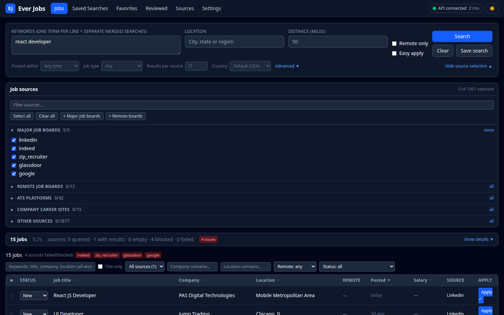
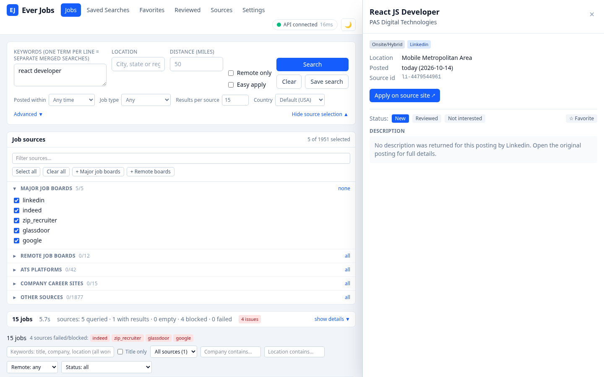
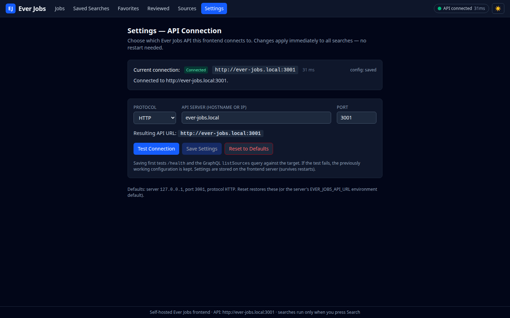
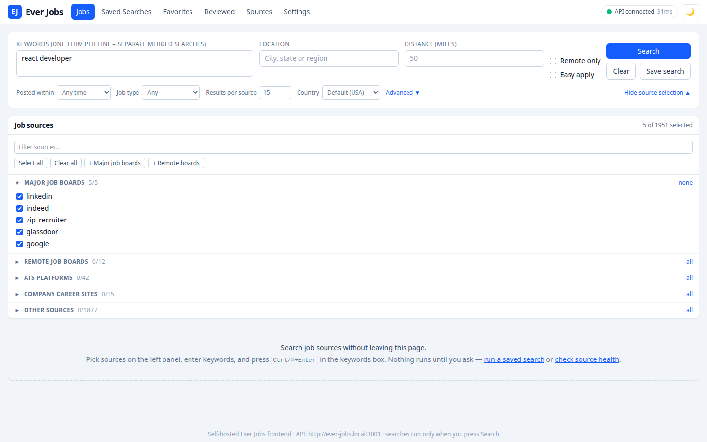

# Ever Jobs UI

A self-hosted web frontend for an [Ever Jobs](#about-the-api) job-search API.
React 19 frontend.


**Search, live:** pick sources explicitly, stream results in, and see exactly
what each source did — returned / empty / blocked / failed, derived from the
stream itself, never re-queried.



## Features

- **Search:** explicit source selection from the live catalogue (~2 000
  sources, categorized; ATS tokens flagged as needing a company slug and
  skipped unless one is given). NDJSON streaming with live progress,
  incremental results, and cancel. One keyword per line = separate merged
  searches.
- **Results:** local keyword filter (all words must match, optional
  title-only), sort, pagination, dedup by `dedupKey`, details drawer with
  sanitized descriptions, and apply links.
- **Per-job state:** favorite, reviewed / not-interested — persisted in
  browser storage with job snapshots, so Favorites & Reviewed pages work even
  without the API.
- **Saved searches:** store the full query; run it (auto-runs on the Jobs
  page) or load it back into the form.
- **Sources page:** live catalogue + the API's circuit-breaker state + what
  this browser actually observed. Unobserved sources are never labeled
  healthy.
- **Settings page:** protocol / host / port only. Test before save; a failed
  test keeps the previously working config; changes apply on the next request
  — no restart.
- Dark/light theme, no auto-search on load, settings and search state
  persisted.

## Screenshots

Job details drawer — sanitized description, source, apply link; on wide
viewports the app reserves a column so the table stays usable beside it:



Settings — the whole API-connection surface. Test runs `/health` plus a
GraphQL `listSources` compatibility probe:



Light mode:



## Quick start

Prerequisites: Node 20+ (the server has **no runtime dependencies**) and npm
for the frontend build.

```bash
# 1. build the frontend
cd web && npm install && npm run build     # outputs web/dist, served by the server

# 2. run the server
cd ../server && PORT=3002 node src/index.js

# 3. open http://localhost:3002, go to Settings,
#    point it at your Ever Jobs API (protocol/host/port), Test, Save.
```

| Env var | Default | Purpose |
|---|---|---|
| `PORT` | `3002` | HTTP port |
| `SETTINGS_FILE` | `server/data/settings.json` | persistent settings path |
| `EVER_JOBS_API_URL` | — | initial API target (overridden by a saved file) |
| `ALLOWED_API_HOSTS` | — | extra proxy targets, comma-separated `host:port` |

## API connection settings

The Settings page configures **protocol / host / port** only (no URL paths).
Built-in defaults: `http` `127.0.0.1` `3001`.

- **Test Connection** runs `/health` + a GraphQL `listSources` compatibility
  probe; results are reported per state (`connected`, `incompatible`,
  `unreachable`, `invalid`, …).
- **Save** tests first; a failed test returns 400 and **keeps the previously
  working configuration**.
- Saved settings persist in `server/data/settings.json` (atomic write) and
  survive restarts. Precedence: file → `EVER_JOBS_API_URL` → built-in
  defaults.
- Changes take effect on the next proxied request — **no restart**.
- The header status dot reflects the *active* target only; testing a
  candidate never overwrites it.

## Security model

- Browser → same-origin `/api/*` only; the proxy forwards to the configured
  target after validating it.
- **SSRF guard:** targets must resolve to trusted private ranges or be listed
  in `ALLOWED_API_HOSTS`; DNS is revalidated on every request (defeats
  DNS-rebinding swaps); redirects are rejected; timeouts per route (search:
  15 min).
- **CSRF:** state-changing requests need the `X-EverJobs-UI: 1` header and a
  same-origin `Origin`; no CORS headers are ever emitted.
- Static serving is jailed to `web/dist` (path traversal rejected); security
  headers + CSP on every response; job descriptions are DOMPurify-sanitized
  before rendering.

## Deploy (systemd)

`deploy/ever-jobs-ui.service` is a template — adjust user/paths, then:

```bash
sudo cp deploy/ever-jobs-ui.service /etc/systemd/system/
sudo systemctl daemon-reload && sudo systemctl enable --now ever-jobs-ui
journalctl -u ever-jobs-ui -f
```

After changing `web/`, just rebuild (`cd web && npm run build`) — the server
reads `web/dist` per request, so frontend changes need no restart. API
connection changes need no restart either (the Settings page writes the
settings file the running process re-reads).

## Development

```bash
cd web && npm run dev      # Vite on :5174, proxies /api → 127.0.0.1:3002
```

Run the server separately (`cd server && PORT=3002 node src/index.js`).

## Layout

```
jobeverui/
├─ server/            Node ESM server (no dependencies)
│  ├─ src/index.js    HTTP server: static files, /api/* routes, proxy
│  ├─ src/settings.js persistent settings store (file > env > defaults)
│  ├─ src/proxy.js    API proxy: DNS revalidation, SSRF policy, streaming
│  ├─ src/validate.js target validation + trusted private ranges
│  └─ data/settings.json  saved API connection (created by the Settings page)
├─ web/               Vite + React 19 + TypeScript + Tailwind v4 frontend
│  └─ src/            pages/components + lib (api, storage, sources, …)
└─ deploy/ever-jobs-ui.service  systemd unit template
```

## About the API

This UI is a frontend for an Ever Jobs–compatible job-search API: a service
exposing `GET /health`, a GraphQL `listSources` catalogue, and a
`POST /search` endpoint that streams NDJSON job results with a terminal
summary line (`{total, complete, stopReason, problemSources[]}`). It is
designed for a **trusted private network** — run both services behind your
LAN or your own auth layer; this app intentionally adds no authentication of
its own.

## Verification

End-to-end flows (streaming search with blocked-source reporting, settings
save → file → immediate effect, failed-save keeps old config, candidate tests
not polluting active status, CSRF 403s, public-IP targets blocked, SPA
fallback, persistence across service restart, favorites/reviewed/saved-search
flows, dark mode) were verified against a live API; see
[docs/REVIEW-FIXES.md](docs/REVIEW-FIXES.md) for a third-party review round
and the 14 fixes that came out of it.
